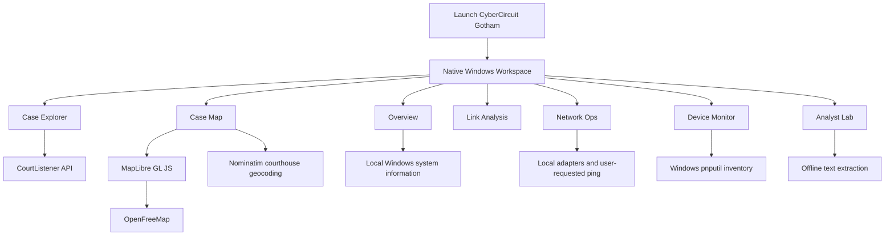

<div align="center">

# ⚡ CyberCircuit Gotham

### A Local-First Intelligence Workspace for Windows

**Research public U.S. court opinions, explore courthouse locations, analyse local system information, and organise connections — all from one native desktop workspace.**

[](https://github.com/)
[](#-system-requirements)
[](https://go.dev/)
[](#)

**CyberCircuit • Intelligence Workspace**

</div>

---

## 🛰️ Overview

CyberCircuit Gotham is a local-first Windows desktop application designed to bring several research and system-analysis tools into one workspace.

The application combines public legal-opinion search, courthouse mapping, local PC monitoring, basic network diagnostics, connected-device inventory, link organisation, and offline text extraction.

Gotham is designed as a research and organisation tool. It does **not** provide access to private databases, identify people using biometrics, or perform unauthorised access or network exploitation.

> **Current release:** `v0.5.0` — Windows x64

## ✨ Features

| Module | What it does |
|---|---|
| **Overview** | Displays CPU utilisation, physical memory, system-drive storage, primary network adapter, and local IPv4 information. |
| **Case Explorer** | Searches CourtListener's published U.S. court opinions using its REST API. |
| **Case Map** | Opens a separate interactive map showing approximate courthouse locations when they can be resolved. |
| **Link Analysis** | Organises up to 32 user-created nodes and connections. |
| **Network Ops** | Displays local network adapter information and can send a standard ping to a hostname or IP address entered by the user. |
| **Device Monitor** | Displays connected-device inventory reported by Windows `pnputil`. |
| **Analyst Lab** | Extracts IPv4 addresses, email addresses, URLs, and frequent terms from text entered by the user. Works offline. |

### 🗺️ Case Map — V0.5.0

The map has been updated to use **MapLibre GL JS** with the **OpenFreeMap** vector map style.

- Opens in a separate browser app window when Microsoft Edge or Google Chrome is available.
- Does not require a Google Maps API key.
- Still opens when no courthouse coordinates have been resolved.
- Shows a general United States view when there are no courthouse pins.
- Displays map attribution for OpenFreeMap, OpenMapTiles, and OpenStreetMap contributors.
- Uses approximate courthouse locations only — never incident locations or personal addresses.

An internet connection is required to load the map library and map style. The public OpenFreeMap service is provided as-is and does not include an uptime SLA. Review its current terms before redistribution or commercial use.

## 🧭 How it works



## 📥 Download and install

### Option 1 — Download the Windows release

1. Open the repository's **Releases** page.
2. Download `CyberCircuitGotham-v0.5.0-Windows-x64.zip`.
3. Extract the ZIP to a folder.
4. Open the `CyberCircuitGotham` folder.
5. Run `CyberCircuitGotham.exe`.

**Requirements:** Windows 10 or Windows 11, 64-bit.

The packaged desktop application does not require Go, Python, Node.js, or a separate browser runtime. A browser such as Microsoft Edge or Google Chrome is used to display the separate interactive map window.

### Windows security notice

The executable in this release is not code-signed. Windows SmartScreen or antivirus software may display a warning because the publisher is not verified or the file has limited reputation.

Only run software you trust. If Microsoft Defender or another antivirus reports a specific threat, do not bypass the warning automatically. Check the detection name and investigate it first.

## 🔎 Using Case Explorer

Case Explorer searches **published U.S. court opinions** indexed by CourtListener.

Example search terms:

- `fraud`
- `homicide sentencing`
- `theft appeal`
- `evidence admissibility`

### Configure the CourtListener API token

1. Create or sign in to a free account at [CourtListener](https://www.courtlistener.com/).
2. Open the [API token page](https://www.courtlistener.com/profile/api-token/).
3. Copy your API token.
4. In Gotham, open the token field and paste the token.
5. Search for a legal topic or issue.

The token is held in application memory for the current session and is not written to the local workspace file. Closing Gotham clears the in-memory token.

**Important:** CourtListener search results are published opinions, not a complete record of every police report, arrest, charge, trial, or criminal investigation. Search results and summaries may be incomplete. Open and read the original source before drawing conclusions.

## 🗺️ Using Case Map

1. Search for opinions in Case Explorer.
2. Open **Case Map**.
3. Select **Open interactive map**.
4. If courthouse locations were resolved, their approximate locations can appear as pins.
5. If no locations were resolved, Gotham still opens a general U.S. map and displays a no-pins notice.

A map with zero pins is not a failed case search. It means the available court names could not be resolved to coordinates.

### Map data and services

- **Map renderer:** [MapLibre GL JS](https://maplibre.org/)
- **Map style and tiles:** [OpenFreeMap](https://openfreemap.org/)
- **Courthouse geocoding:** [OpenStreetMap Nominatim](https://nominatim.org/)
- **Legal opinion search:** [CourtListener](https://www.courtlistener.com/)

These services are external dependencies and require internet access. Their availability, policies, and terms may change. Respect each provider's current usage policy and attribution requirements.

## 🧩 Other workspace modules

### Link Analysis
Create and connect up to 32 nodes to organise relationships or concepts you enter yourself. Connections use the `source -> target` format.

### Network Ops
Inspect local network adapter information and send a standard ping to a hostname or IP address you specify. This is a basic diagnostic feature, not a network scanner or exploitation tool.

### Device Monitor
Displays device inventory information reported by the Windows `pnputil` utility.

### Analyst Lab
Paste text to extract common indicators such as IPv4 addresses, email addresses, URLs, and frequent terms. Extraction is local and pattern-based; it is not an AI investigation engine.

## 🔐 Privacy and local data

Gotham stores its local workspace data under:

```text
%APPDATA%\CyberCircuitGotham\workspace.json
```

Successful courthouse geocoding results are cached under:

```text
%APPDATA%\CyberCircuitGotham\court_geo_cache.json
```

### Data sent to external services

| Service | Data sent |
|---|---|
| CourtListener | Search queries and API requests for public opinions |
| OpenStreetMap Nominatim | Courthouse names submitted for geocoding |
| OpenFreeMap | Map-style and map-tile requests needed to display the map |
| CDN hosting MapLibre | Requests to load the MapLibre JavaScript library |

The API token is not saved to the workspace file. Do not enter confidential, personal, medical, biometric, or otherwise sensitive information into external search services.

## 🛠️ Build from source

The source code is written in Go and uses the Windows native GUI APIs.

### Requirements

- Windows 10 or Windows 11 (64-bit)
- Go 1.23 or newer

### Build

1. Install Go from [go.dev/dl](https://go.dev/dl/).
2. Clone this repository:

   ```powershell
   git clone https://github.com/YOUR-USERNAME/YOUR-REPOSITORY.git
   cd YOUR-REPOSITORY
   ```

3. Run the build script:

   ```powershell
   .\BUILD-WINDOWS.bat
   ```

4. The executable will be generated as `CyberCircuitGotham.exe` in the project folder.

The project currently has no third-party Go module dependencies. The interactive map loads its JavaScript library and map style from external services at runtime.

## 🗂️ Project files

```text
CyberCircuitGotham/
├── CyberCircuitGotham.exe    # Windows x64 application
├── main_windows.go           # Main application source
├── go.mod                    # Go module definition
├── BUILD-WINDOWS.bat         # Build script
├── LAUNCH.bat                # Launch helper
├── VERSION.txt               # Version information
└── README.md                 # Project documentation
```

## ⚠️ Scope, limitations and responsible use

- Case Explorer currently searches CourtListener's collection of published U.S. court opinions. It is not a global legal-records search engine.
- A published opinion is not proof that every allegation in the matter was true.
- Opinions may omit evidence, personal details, or parts of the underlying event.
- Court pins represent approximate courthouse locations, not incident scenes, residences, or the location of any individual.
- Court geocoding may return no result for some court names.
- The app does not match fingerprints, DNA, blood types, face templates, or other biometric or medical identifiers.
- The app is not designed to build private-person dossiers, track individuals, access accounts without permission, or exploit networks.
- Network diagnostics should only be used on systems and networks you own or are authorised to test.

Use public information responsibly, verify original sources, and follow applicable laws and service terms.

## 🤝 Contributing

Issues, bug reports, and suggestions are welcome.

When reporting a bug, include:

1. Gotham version.
2. Windows version.
3. The module where the issue occurred.
4. The exact error message.
5. Steps to reproduce the issue.

Do not include API tokens, passwords, private records, or other secrets in issue reports.

## 📜 License

No license is included in this release. Until a license is added, the source code is publicly viewable but is **not automatically open-source or licensed for reuse**. A repository owner should choose and add a license before accepting contributions or granting reuse rights.

## 🏷️ Version

- **Application:** CyberCircuit Gotham
- **Release:** `v0.5.0`
- **Platform:** Windows 10/11 x64
- **Language:** Go
- **Interface:** Native Win32 desktop GUI
- **Package:** Portable ZIP distribution

---

<div align="center">

**CYBERCIRCUIT GOTHAM**

*Public information. Local analysis. One workspace.*

</div>
